<p><picture><source media="(max-width: 600px)" srcset="assets/readme/hero-mobile.svg"/>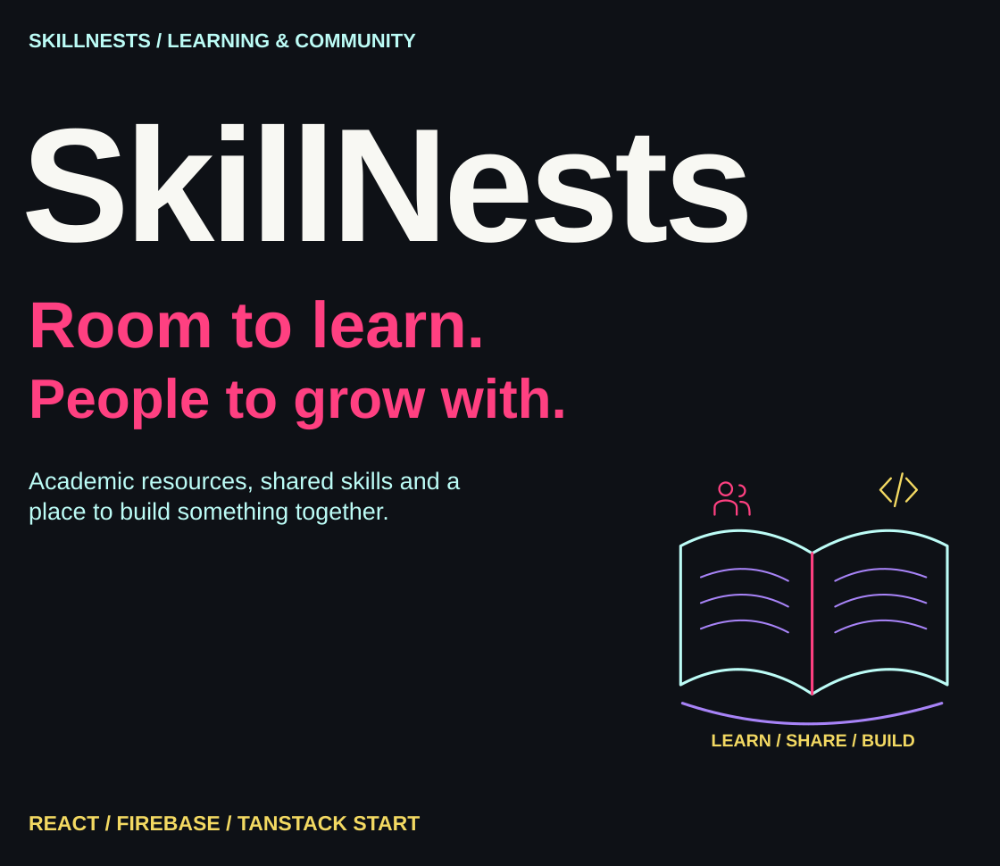</picture></p>

<p align="center"><a href="#the-learning-space">Overview</a> · <a href="#more-than-one-way-to-learn">Community</a> · <a href="#how-the-application-connects">Architecture</a> · <a href="#run-locally">Run locally</a> · <a href="#configuration-and-deployment">Configure</a> · <a href="#explore-the-source">Source</a></p>

<a id="the-learning-space"></a>

##  The learning space

I built SkillNests around learning that has room for more than an exam score: academic resources, conversations, creative skills and the things students can build together. The application brings those areas into one signed-in workspace with content tools, community features and personal progress views.

<p><picture><source media="(max-width: 600px)" srcset="assets/readme/features-mobile.svg"/>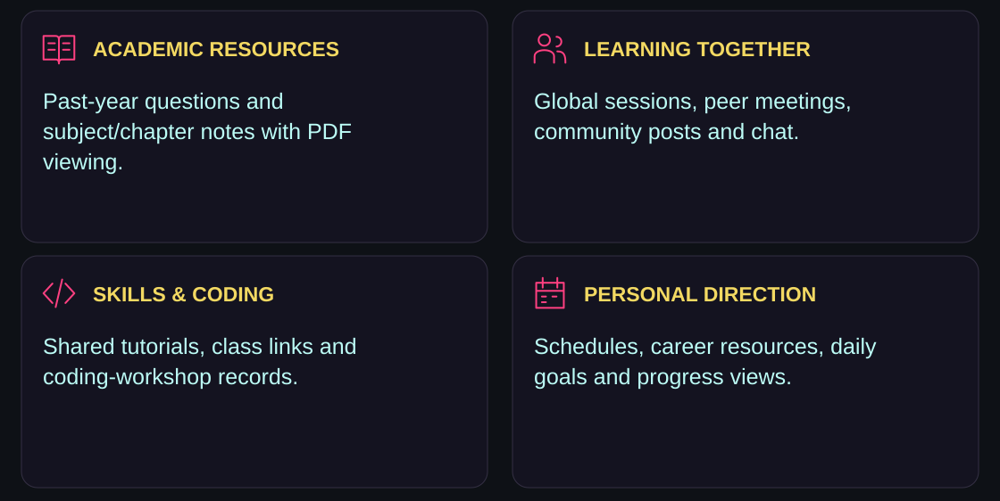</picture></p>

Past-year questions can be organized by stream, subject, class and year. Notes use subject/chapter navigation and a PDF viewer, including handling for Google Drive links. Content is managed through the application’s stores and admin interfaces; resource availability depends on the connected project’s data.

<a id="more-than-one-way-to-learn"></a>

##  More than one way to learn

<p><picture><source media="(max-width: 600px)" srcset="assets/readme/community-mobile.svg"/>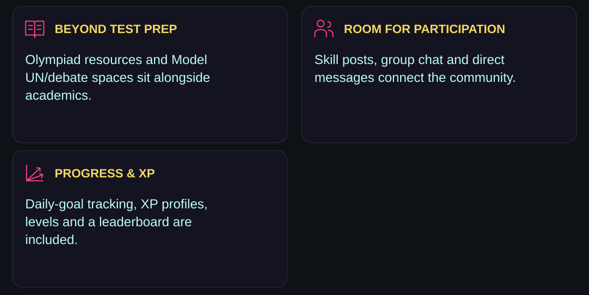</picture></p>

| Area | Included interface and data workflow |
|---|---|
| Meeting hub | Global and peer sessions with external meeting links |
| Skill share | Tutorial posts, video links and class links |
| Coding | Workshop records with language, level, time and meeting URL |
| Career guidance | Live-session links and recorded-resource entries |
| Schedule | Academic, extracurricular, career and other events |
| Olympiads | Subject, topic, date and resource records |
| MUN and debate | Committee resources, debate posts and comments |
| Progress | Daily goals, completion flags, XP profiles and levels |
| Community | Group chat, direct messages and founder inbox |

The original product direction emphasizes a supportive space. The current code also includes an XP leaderboard, so the README does not claim that ranking features are absent. Meeting links open external services; the project is not a built-in video-conferencing engine.

<a id="how-the-application-connects"></a>

##  How the application connects

<p><picture><source media="(max-width: 600px)" srcset="assets/readme/architecture-mobile.svg"/>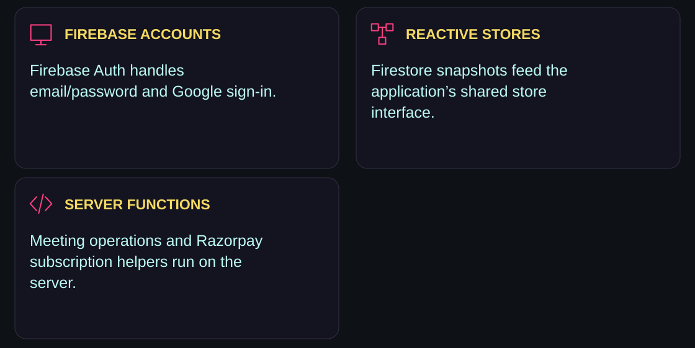</picture></p>

React 19 and TanStack Start/Router provide the web application and routes. Tailwind CSS v4, Radix/shadcn components, Lucide and Framer Motion support the interface. Firebase Auth and Firestore provide accounts and persistent records.

Despite its name, `createLocalStore` is currently **Firestore-backed**. It keeps an in-memory cache, subscribes with `onSnapshot`, and writes record differences to Firestore. Local browser storage is used for some interface state such as seen-resource IDs; the app is not an offline-only local store.

Razorpay server helpers create, verify and manage subscription records. Paid gates and account state connect premium access to the application UI. These are implemented integration paths, not evidence that live payments or all permission cases have been independently validated.

<a id="run-locally"></a>

##  Run locally

<p><picture><source media="(max-width: 600px)" srcset="assets/readme/environment-mobile.svg"/>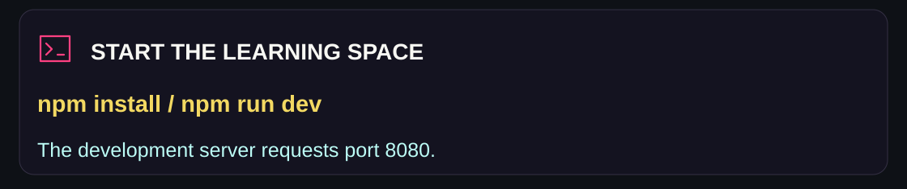</picture></p>

Use a Node release compatible with the pinned Vite 8 toolchain and npm:

```bash
git clone https://github.com/adilsukumar/SkillNests.git
cd SkillNests
npm install
npm run dev
```

The server requests `http://localhost:8080`; follow the actual URL printed by Vite if that port is in use.

```bash
npm run lint
npm run build
npm run preview
```

The package also declares `npm run build:dev` and `npm run format`. There is currently no dedicated automated test script.

<a id="configuration-and-deployment"></a>

##  Configuration and deployment

<p><picture><source media="(max-width: 600px)" srcset="assets/readme/setup-mobile.svg"/>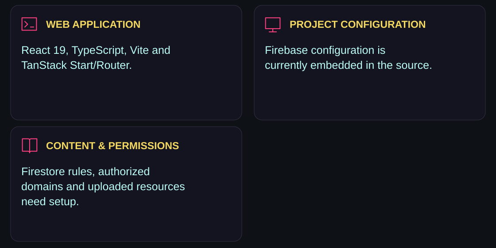</picture></p>

### Firebase

The current [Firebase module](src/lib/firebase.ts) contains a project configuration directly. The `VITE_FIREBASE_*` variables from the older README are not read by that module. When adapting the project, update the configuration deliberately and keep its project identity consistent with the meeting-server token verification.

Follow [FIREBASE_SETUP.md](FIREBASE_SETUP.md) to enable email/password and Google sign-in, create Firestore, configure authorized domains and publish [firestore.rules](firestore.rules). The setup notes and auth code include a designated founder/admin email; review that identity for your own deployment. Firebase client configuration does not replace database rules or server authorization.

### Server integrations

| Variable | Used by |
|---|---|
| `FIREBASE_SERVICE_ACCOUNT_JSON` | Server-side meeting functions and Firestore REST access |
| `RAZORPAY_KEY_ID` | Server-side Razorpay requests |
| `RAZORPAY_KEY_SECRET` | Server-side Razorpay authentication and signature verification |
| `RAZORPAY_WEBHOOK_SECRET` | Razorpay webhook verification |

Keep service-account JSON and payment secrets in the server environment. Do not expose them through `VITE_` variables or commit credential files. A frontend `.env` key name from the old README does not configure these server helpers.

### Hosted build

This is a TanStack Start application with server functions. The repository’s [Vercel configuration](vercel.json) publishes `dist/client` and routes requests through [api/index.js](api/index.js), including `dist/server`. Use the matching server deployment rather than treating the build as a standalone static directory.

Auth, content, meetings and paid areas depend on the connected Firebase project, Firestore rules, stored resources and relevant server secrets. Check those integrations using a test account and payment test mode before accepting real subscriptions.

<a id="explore-the-source"></a>

##  Explore the source

<p align="center"><a href="src/stores/index.ts">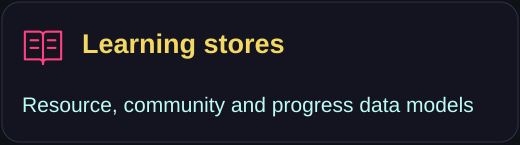</a> <a href="src/lib/local-store.ts">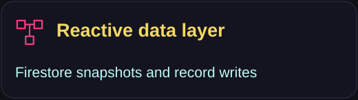</a> <a href="src/lib/meetings.functions.ts">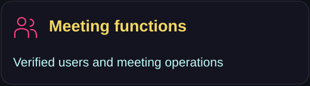</a> <a href="FIREBASE_SETUP.md">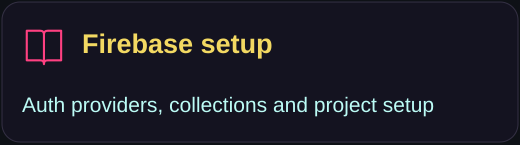</a></p>

| Area | Source |
|---|---|
| Past-year papers | [pyq.tsx](src/routes/_authenticated/pyq.tsx) |
| Notes | [notes.tsx](src/routes/_authenticated/notes.tsx) |
| Skill sharing | [skill-share.tsx](src/routes/_authenticated/skill-share.tsx) |
| Meetings | [meetings.tsx](src/routes/_authenticated/meetings.tsx) |
| Progress and leaderboard | [progress.tsx](src/routes/_authenticated/progress.tsx) · [leaderboard.tsx](src/routes/_authenticated/leaderboard.tsx) |
| Subscription helpers | [razorpay.functions.ts](src/lib/razorpay.functions.ts) |
| Webhook handler | [razorpay.ts](src/routes/api/public/hooks/razorpay.ts) |
| PDF presentation | [DrivePdfViewer.tsx](src/components/DrivePdfViewer.tsx) |

```text
src/routes/             public and authenticated application routes
src/components/         site sections, resource viewers and UI
src/stores/             resource and community data models
src/lib/                Firebase, auth, stores and server functions
firestore.rules         database access rules
FIREBASE_SETUP.md       project provisioning notes
api/index.js            hosted server entry
```

<p><picture><source media="(max-width: 600px)" srcset="assets/readme/closing-mobile.svg"/>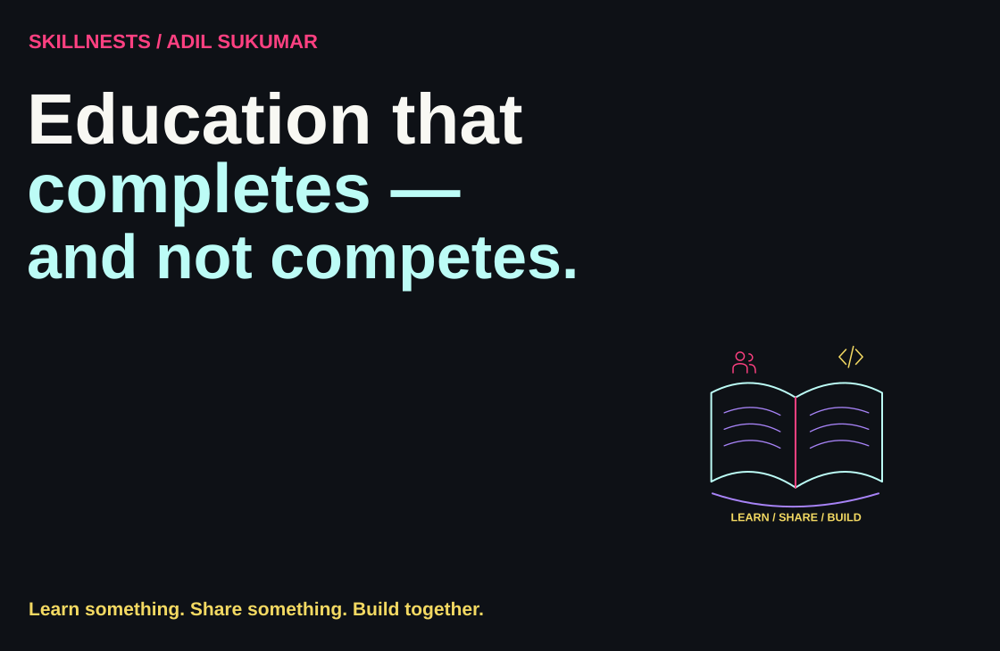</picture></p>

<p align="center"><a href="https://github.com/adilsukumar/SkillNests/issues">Discuss an improvement</a> · <a href="src/stores/index.ts">Explore the learning models</a> · <a href="https://www.adilsukumar.xyz/">Meet the builder</a></p>
